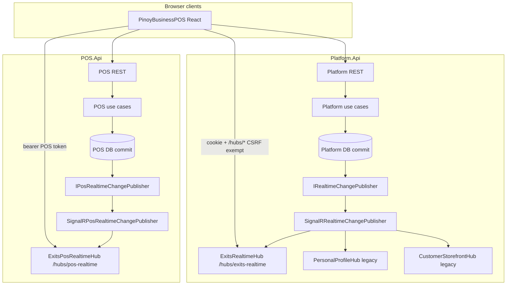

# ExItS Realtime (SignalR) Architecture

## Document status

| Field | Value |
|---|---|
| Status | **Authoritative architecture (Platform + POS realtime Phase 2)** |
| Evidence base | Git `HEAD` `50041e1bf` plus **uncommitted** realtime work in the working tree (not yet on `origin/main`) |
| Last reviewed | 2026-10-24 |
| Sync contract | Platform: `RealtimeEventTypes.cs` ↔ `realtime-event-types.ts` ↔ Section 25. POS: `PosRealtimeEventTypes.cs` ↔ `pos-realtime-event-types.ts` ↔ Section 25b |

Legend used throughout:

| Label | Meaning |
|---|---|
| **IMPLEMENTED** | Shipped in code today (including uncommitted realtime work on this branch) |
| **PARTIAL** | Material code exists but coverage, E2E verification, or client wiring is incomplete |
| **PLANNED** | Designed or stubbed; not fully wired end-to-end |
| **NOT SUPPORTED** | Explicit non-goals for MVP / current architecture |

---

## 1. Purpose

**IMPLEMENTED.** ExItS uses ASP.NET Core SignalR to push **change notifications** after successful persistence. Clients treat notifications as **hints to refetch** authoritative REST APIs — not as a replicated database or command channel.

| API | Hub | Auth |
|---|---|---|
| **Platform.Api** | `/hubs/exits-realtime` | Cookie session + CSRF exempt on `/hubs/*` |
| **POS.Api** | `/hubs/pos-realtime` | Bearer token (POS access) |

Goals:

- Multi-tab and multi-device freshness for Platform-owned settings (organization profile, branch fulfillment, delivery policy/areas, personal profile/preferences, profile photo, membership access).
- Personal customer storefront availability (hours, pause, fulfillment toggles) without polling; linked customers may join storefront seller groups.
- POS customer-order lifecycle, payment status, connected commerce / payment-method settings, and catalog pricing hints without polling sell-floor boards.
- A canonical envelope per API so PinoyBusinessPOS React shares one connection pattern per host.

Non-goals (unchanged):

- Guaranteed delivery or cross-instance fan-out without additional infrastructure (**NOT SUPPORTED** for MVP).
- SignalR as command channel or authoritative state (**NOT SUPPORTED**).

**PARTIAL:** Multi-session E2E — personal settings / reconnect / notifications / WS (Docker + Cloudflare) **verified** 2026-10-24 on LV `:5177`; org/orders/payments/inventory/utang/permissions **not executed** (LV org catalog identities absent in this DB). Sale-checkout stock path does not publish `InventoryStockChanged` separately (order/payment events cover checkout). Redis backplane **NOT SUPPORTED** until horizontal scale requires it.

---

## 2. Boundaries

| Layer | Owns realtime? | Notes |
|---|---|---|
| **Platform.Api** | Yes | `ExitsRealtimeHub`, envelope publish, legacy dual-publish hubs |
| **Platform.Application** | Contract only | `RealtimeEventEnvelope`, `IRealtimeChangePublisher`, `RealtimePublish` — no SignalR references |
| **Platform.Admin (Blazor)** | No | No SignalR client in Admin MVP |
| **POS.Api** | Yes | `ExitsPosRealtimeHub`, `IPosRealtimeChangePublisher`, order/payment/settings/catalog publishers |
| **POS.Application** | Contract only | `PosRealtimeEventEnvelope`, `PosRealtimePublish` — no SignalR references |
| **PinoyBusinessPOS React** | Consumer | Platform: `exits-realtime-connection` + cookie. POS: `pos-realtime-connection` + bearer |
| **Product databases** | Never | Realtime does not read or write cross-product DBs; no cross-product FKs |

Portfolio rules preserved:

- Platform operational data stays in the Platform database; POS operational data in the POS database.
- Personal, Organization, and Platform Admin surfaces remain separate; realtime groups are scoped by membership, linked-customer relationship, or explicit authorized join — not by client-invented group names (**NOT SUPPORTED**).

---

## 3. End-to-end diagram

**IMPLEMENTED** Platform and POS paths (solid). **PLANNED** items noted in Section 27.

---

## 4. Source of truth

**NOT SUPPORTED:** SignalR as source of truth.

**IMPLEMENTED** rule:

- Every envelope is a **notification** that something changed.
- Clients **must** refetch via existing REST/query clients (`invalidateQueries`, targeted `setQueryData` where the payload is explicitly non-authoritative, e.g. profile photo URL hint).
- If SignalR is disconnected, stale, or missed, REST polling, navigation, manual refresh, and reconnect refetch hooks remain correct.

---

## 5. RealtimeEventEnvelope

**IMPLEMENTED** in both stacks (Platform and POS share the same field shape).

| Field | Type | Required | Description |
|---|---|---|---|
| `EventId` | `Guid` | Yes | Unique per emission; used for client dedupe |
| `EventType` | `string` | Yes | Stable name from `RealtimeEventTypes` / `PosRealtimeEventTypes` |
| `SchemaVersion` | `int` | Yes | `CurrentSchemaVersion = 1` |
| `OccurredAtUtc` | `DateTimeOffset` | Yes | Server clock at publish time |
| `ResourceType` | `string` | Yes | e.g. `organization`, `branch`, `customer-order` |
| `ResourceId` | `string` | Yes | Usually GUID `D` format |
| `ScopeType` | `string` | Yes | Platform: `personal-user`, `organization`, `branch`, `storefront-seller`. POS adds `order`, `personal-buyer` |
| `ScopeId` | `string?` | No | Scope identifier (often org or user id) |
| `ResourceVersion` | `string?` | No | Opaque version (e.g. `UpdatedAtUtc` unix ms) |
| `CorrelationId` | `string?` | No | Reserved for future HTTP ↔ realtime tracing |
| `Data` | `Dictionary<string,string>?` | No | Small string hints only — not full entities |

Factory: `RealtimeEventEnvelope.Create(...)` (Platform); POS equivalent on `PosRealtimeEventEnvelope`.

---

## 6. Client wire methods

**IMPLEMENTED.**

| Host | Hub path | Hub class | Server → client method | Payload |
|---|---|---|---|---|
| Platform | `/hubs/exits-realtime` | `ExitsRealtimeHub` | `RealtimeEvent` | Platform envelope |
| POS | `/hubs/pos-realtime` | `ExitsPosRealtimeHub` | `PosRealtimeEvent` | POS envelope |

React normalizes PascalCase/camelCase via `normalizeRealtimeEnvelope` / `normalizePosRealtimeEnvelope`.

---

## 7. Hub inventory

| Hub | Path | Status | Role |
|---|---|---|---|
| `ExitsRealtimeHub` | `/hubs/exits-realtime` | **IMPLEMENTED** | Canonical Platform envelope hub |
| `PersonalProfileHub` | `/hubs/personal-profile` | **IMPLEMENTED** (legacy) | `ProfilePhotoUpdated` dual-publish |
| `CustomerStorefrontHub` | `/hubs/customer-storefront` | **IMPLEMENTED** (legacy) | `StorefrontAvailabilityChanged` dual-publish |
| `ExitsPosRealtimeHub` | `/hubs/pos-realtime` | **IMPLEMENTED** | POS orders, payments, org settings hints |

All mapped hubs use `.RequireAuthorization()`.

---

## 8. ExitsRealtimeHub behavior

**IMPLEMENTED** (`ExitsRealtimeHub.cs`).

**On connect**

- Authenticated users are added automatically to `RealtimeGroupNames.PersonalUser(userId)`.

**Explicit join methods**

| Method | Authorization | Group |
|---|---|---|
| `JoinOrganization(organizationId)` | Active org membership lookup | `rt:organization:{orgId}` |
| `LeaveOrganization(organizationId)` | Connection-scoped | Removes from org group |
| `JoinStorefrontSeller(organizationId)` | Active org membership **or** active linked Personal customer (`ILinkedCustomerAppUserRepository`) | `rt:storefront-seller:{orgId}` |
| `LeaveStorefrontSeller(organizationId)` | Connection-scoped | Removes from storefront seller group |

**NOT SUPPORTED:** Client-supplied arbitrary group names or hub methods that add connections to groups without server checks.

**PLANNED:** Auto-join branch groups when a staff session binds to a branch (today branch groups receive publishes from server but clients do not call a dedicated join API).

---

## 9. ExitsPosRealtimeHub behavior

**IMPLEMENTED** (`ExitsPosRealtimeHub.cs`).

**On connect**

- Authenticated users join `PosRealtimeGroupNames.PersonalBuyer(userId)` for buyer-scoped order events.

**Explicit join methods**

| Method | Authorization | Group |
|---|---|---|
| `JoinOrganization(organizationId)` | `PosRealtimeHubAuthorization.TryAuthorizeSellerOrganization` (commercial access) | `pos:organization:{orgId}` |
| `LeaveOrganization(organizationId)` | Connection-scoped | Removes from org group |
| `JoinOrder(organizationId, orderId)` | Seller org access or buyer order ownership | `pos:order:{orgId}:{orderId}` |
| `LeaveOrder(...)` | Connection-scoped | Removes from order group |

---

## 10. Group naming

**IMPLEMENTED.**

Platform (`RealtimeGroupNames`):

| Group helper | Pattern |
|---|---|
| `PersonalUser` | `rt:personal-user:{userId}` |
| `Organization` | `rt:organization:{organizationId}` |
| `Branch` | `rt:branch:{organizationId}:{branchId}` |
| `StorefrontSeller` | `rt:storefront-seller:{organizationId}` |
| Legacy personal / storefront | `personal-profile:{userId}`, `customer-storefront:seller:{orgId}` |

POS (`PosRealtimeGroupNames`):

| Group helper | Pattern |
|---|---|
| `Organization` | `pos:organization:{organizationId}` |
| `Order` | `pos:order:{organizationId}:{orderId}` |
| `PersonalBuyer` | `pos:personal-buyer:{userId}` |

---

## 11. Authentication and session

**IMPLEMENTED.**

- **Platform:** Browser clients connect with `withCredentials: true`. Hubs require `[Authorize]`. Platform browser antiforgery middleware **exempts** paths starting with `/hubs/` so SignalR negotiate/WebSocket upgrades are not blocked by CSRF checks — exemption is **path-scoped** and documented in `PlatformBrowserAntiforgeryMiddleware` (negotiate cookie auth; REST remains protected).
- **POS:** Browser clients connect with bearer token from `getPosAccessToken()` on the POS hub URL.

**NOT SUPPORTED:** Anonymous storefront realtime (customers must be signed in to Personal to join seller storefront groups). Streaming card data or secrets over SignalR (**NOT SUPPORTED**).

---

## 12. Publisher abstraction

**IMPLEMENTED.**

| Type | Location | Behavior |
|---|---|---|
| `IRealtimeChangePublisher` | Platform.Application | `PublishToGroupsAsync(groups, envelope)` |
| `NullRealtimeChangePublisher` | Platform.Application | No-op for tests / optional DI |
| `SignalRRealtimeChangePublisher` | Platform.Api | Sends `RealtimeEvent` to each distinct group; logs and swallows transport errors |
| `RealtimePublish` | Platform.Application | Envelope builders for org, branch, personal, membership |
| `IPosRealtimeChangePublisher` | POS.Application | Same contract shape for POS envelopes |
| `SignalRPosRealtimeChangePublisher` | POS.Api | Sends `PosRealtimeEvent` |
| `PosRealtimePublish` | POS.Application | Order, payment, settings, catalog helpers |

Use cases accept optional publishers and default to null implementations for unit tests.

---

## 13. Post-commit publish discipline

**IMPLEMENTED** pattern:

1. Validate and mutate domain.
2. `SaveChangesAsync`.
3. Publish realtime (and legacy notifiers where applicable).

Publish failures **must not** roll back committed data (publishers catch and log).

**PLANNED:** Transactional outbox for at-least-once cross-process delivery (Section 21).

---

## 14. Dual-publish (legacy Platform hubs)

**IMPLEMENTED** during migration.

| Legacy hub | Legacy client method | Envelope event | Notes |
|---|---|---|---|
| `PersonalProfileHub` | `ProfilePhotoUpdated` | `PersonalProfilePhotoChanged` | `SignalRPersonalProfilePhotoNotifier` |
| `CustomerStorefrontHub` | `StorefrontAvailabilityChanged` | `StorefrontAvailabilityChanged` | Rich DTO on legacy; envelope carries string flags in `Data` |

React **IMPLEMENTED** migration:

- `PersonalAvatarProvider` listens on shared hub for `PersonalProfilePhotoChanged`.
- `useCustomerStorefrontRealtime` uses shared hub + `JoinStorefrontSeller`.

Legacy hubs remain mapped until all clients confirm envelope-only consumption.

---

## 15. Platform settings — implemented publishers

**IMPLEMENTED** publish after successful commit:

| Use case | Event type(s) | Primary groups |
|---|---|---|
| `UpdateOrganizationProfile` | `OrganizationSettingsChanged` | Organization |
| `UpdatePersonalProfile` | `PersonalSettingsChanged` | Personal user (+ legacy personal profile) |
| `UpdatePersonalAccountSettings` | `PersonalSettingsChanged` | Personal user (+ legacy) |
| `UploadPersonalProfilePhoto` | `PersonalProfilePhotoChanged` (via notifier) | Personal user (+ legacy) |
| `UpdateBranch` | `BranchSettingsChanged` | Org + branch |
| `UpsertBranchOperatingHours` | `BranchOperatingHoursChanged` + storefront notifier | Org, branch, storefront seller (+ legacy) |
| `UpdateBranchFulfillmentSettings` | `BranchFulfillmentSettingsChanged` + storefront notifier | Same branch fan-out |
| `SetBranchOnlineOrdersPaused` | `BranchFulfillmentSettingsChanged` + storefront notifier | Same (availability snapshot) |
| `UpsertBranchDeliveryPolicy` | `BranchDeliveryPolicyChanged` | Org + branch |
| Add / deactivate delivery service areas | `BranchDeliveryAreasChanged` | Org + branch |
| `RevokeOrganizationMembership`, suspend / unsuspend membership | `MembershipAccessChanged` | Personal user + organization |
| `ChangeOrganizationRole` | `MembershipAccessChanged` | Personal user + organization |
| `UpdatePersonalSharedUtangPreference` | `PersonalSettingsChanged` (`Data.kind=shared-utang-preference`) | Owner + counterparty **personal-user** groups |

Storefront notifier emits both legacy `StorefrontAvailabilityChanged` and envelope `StorefrontAvailabilityChanged`.

**IMPLEMENTED — Personal Utang:** Shared preference updates notify both parties. Ledger entry record/confirm/dispute/cancel, settlement/repayment, invitations (create/accept), and notification-hint events publish to **authorized personal-user groups only** (private ledger → owner; shared linked → both linked users). Payload = ids/`kind` only — never amounts, notes, or preview text.

---

## 16. POS operational realtime

**IMPLEMENTED** (core path) / **PARTIAL** (inventory).

| Area | Status | Notes |
|---|---|---|
| Customer order lifecycle transitions | **IMPLEMENTED** | Post-commit publish from `CustomerOrderUseCases` |
| `PaymentStatusChanged` | **IMPLEMENTED** | Post-commit on payment status mutations |
| `ConnectedCommerceSettingsChanged` | **IMPLEMENTED** | `UpdateOrganizationConnectedCommerceSettings` |
| `PaymentMethodSettingsChanged` | **IMPLEMENTED** | Payment method use cases |
| `CatalogPricingChanged` | **IMPLEMENTED** | After Today's Prices (`UpdateCatalogProductPrices`) |
| `InventoryStockChanged` | **IMPLEMENTED** | Post-commit publish: adjust, transfer dispatch/receive, stock-use, waste/loss, stock-count complete, direct purchase, stock-request create/approve/reject/cancel. Client invalidates inventory, transfers, stock-requests, catalog, storefront |

Authoritative order, payment, catalog, and inventory state remains POS REST + database; SignalR only invalidates queries.

---

## 17. Idempotency

**IMPLEMENTED (client) / PARTIAL (server).**

| Layer | Behavior |
|---|---|
| Server | New `EventId` per publish; no replay buffer |
| Client | Platform: `applyRealtimeEventToQueries` dedupes identical `eventId` within **5 seconds** |
| REST | Existing concurrency tokens (`ExpectedVersion` on settings) remain authoritative |

**PLANNED:** Server-side idempotent publish records if outbox is adopted.

**NOT SUPPORTED:** Using SignalR alone to reconcile conflicting edits.

---

## 18. Reconnection and group membership

**IMPLEMENTED** in `exits-realtime-connection.ts` and `pos-realtime-connection.ts`.

- Automatic reconnect schedules: `[0, 2000, 5000, 10000, 30000]`.
- **Initial connection** retry backoff: `[0, 1000, 2000, 5000, 10000, 20000]` before first successful start (Platform).
- On `onreconnected`, clears local join tracking and re-invokes remembered `JoinOrganization` / `JoinStorefrontSeller` / POS joins.
- `ExitsRealtimeProvider` registers `onReconnected` hooks to invalidate session, workspaces, personal, storefront, and branch-fulfillment queries (missed-event recovery).
- Connection managers use ref-counted `subscribe()` so multiple hooks share one physical connection per hub host.

**PARTIAL:** Multi-tab reconnect integration tests and automated multi-session E2E (Section 24).

---

## 19. Transactional outbox decision

| Option | Status | Rationale |
|---|---|---|
| Fire-and-forget after commit | **IMPLEMENTED** | Simple MVP; matches “notification not source of truth” |
| Transactional outbox + dispatcher | **PLANNED** | Needed for guaranteed delivery, cross-instance fan-out, or retry analytics |
| Outbox in product DBs for Platform settings | **NOT SUPPORTED** | Platform publish stays Platform-scoped |

---

## 20. Multi-instance deployment

**IMPLEMENTED today:** Single-instance SignalR per API host (in-memory backplane default).

**NOT SUPPORTED for MVP:** Redis / Azure SignalR backplane (not configured).

Implication: horizontal scale-out **without** a backplane will not deliver realtime across instances (**PLANNED** ops documentation when scaling is required).

---

## 21. Performance

**IMPLEMENTED** expectations:

- Small string dictionaries in envelopes — no entity graphs.
- Publisher loops distinct group names once per event.
- Client invalidates targeted query keys — not full cache flush (`realtime-query-map.ts`, `pos-realtime-query-map.ts`).

**PLANNED:** Load testing with realistic org fan-out, order watchers, and storefront watcher counts.

---

## 22. Diagnostics

**IMPLEMENTED:**

- Publishers log warnings on publish failure (event type + resource).
- SignalR client logging at `LogLevel.Warning` in React managers.

**PLANNED:**

- Correlation id propagation from HTTP request into envelope `CorrelationId`.
- Metrics (connected clients, publish latency, reconnect rate).

---

## 23. Testing

**IMPLEMENTED:**

| Test | Location |
|---|---|
| Envelope schema version + group name stability | `tests/ExItS.Platform.UnitTests/Realtime/RealtimeEventEnvelopeTests.cs` |
| Query dedupe + storefront invalidation | `src/Products/PinoyBusinessPOS/.../realtime/realtime-query-map.test.ts` |

**PARTIAL:**

- Multi-session E2E (two Playwright contexts against Docker LV `:5177` + Cloudflare `my.exitsapps.com`) — **partial PASS** 2026-10-24: personal dual-session `PersonalSettingsChanged`, reconnect restore, cross-user isolation, unauthorized soft-join, connection-request `PersonalNotificationChanged`, Platform negotiate WebSockets via nginx and Cloudflare. Org/orders/payments/inventory/utang/permissions **UNVERIFIED** (no seeded org owner/staff/utang pair in this LV database).

**PLANNED:**

- Hub integration tests with `WebApplicationFactory` + test auth.
- Playwright realtime smoke in CI.

Vitest skips hub start when `import.meta.env.MODE === "test"`.

---

## 24. Event type registry — Platform

Keep aligned with `RealtimeEventTypes.cs` and `realtime-event-types.ts`.

| EventType | Status | Typical publishers | Client action (React) |
|---|---|---|---|
| `OrganizationSettingsChanged` | **IMPLEMENTED** | `UpdateOrganizationProfile` | Invalidate org profile queries |
| `BranchSettingsChanged` | **IMPLEMENTED** | `UpdateBranch`, generic branch publish | Branch / fulfillment queries |
| `BranchOperatingHoursChanged` | **IMPLEMENTED** | `UpsertBranchOperatingHours` | Branch hours + storefront |
| `BranchFulfillmentSettingsChanged` | **IMPLEMENTED** | Fulfillment update / pause | Fulfillment + storefront |
| `BranchDeliveryPolicyChanged` | **IMPLEMENTED** | `UpsertBranchDeliveryPolicy` | Branch fulfillment + delivery policy |
| `BranchDeliveryAreasChanged` | **IMPLEMENTED** | Add / deactivate delivery areas | Branch delivery areas |
| `StorefrontAvailabilityChanged` | **IMPLEMENTED** | Storefront notifier | Storefront + merchant probe queries |
| `PersonalSettingsChanged` | **IMPLEMENTED** | Profile, account settings, shared Utang prefs | Personal profile + account settings (+ utang prefs when `kind=shared-utang-preference`) |
| `PersonalProfilePhotoChanged` | **IMPLEMENTED** | Photo upload notifier | Avatar + profile cache patch |
| `MembershipAccessChanged` | **IMPLEMENTED** | Revoke, suspend/unsuspend, change role | Session, workspaces, POS capabilities |
| `PersonalUtangEntryChanged` | **IMPLEMENTED** | Record / confirm / dispute / cancel / settlement | `["personal","utang"]` — authorized personal-user groups only |
| `PersonalUtangInvitationChanged` | **IMPLEMENTED** | Invitation create / accept | `["personal","utang"]` — inviter + invitee when linked |
| `PersonalNotificationChanged` | **IMPLEMENTED** | Hint after Utang notifications | `["personal","notifications"]` (+ utang lists) — recipient only |

---

## 25. Event type registry — POS

Keep aligned with `PosRealtimeEventTypes.cs` and `pos-realtime-event-types.ts`.

| EventType | Status | Typical publishers | Client action (React) |
|---|---|---|---|
| `CustomerOrderSubmitted` … `CustomerOrderCompleted` | **IMPLEMENTED** | Order lifecycle use cases | `seller-orders`, `personal/my-orders`, order detail keys |
| `PaymentStatusChanged` | **IMPLEMENTED** | Payment status mutations on orders | Same order query family |
| `ConnectedCommerceSettingsChanged` | **IMPLEMENTED** | `UpdateOrganizationConnectedCommerceSettings` | Connected commerce + related org keys |
| `PaymentMethodSettingsChanged` | **IMPLEMENTED** | Payment method settings saves | Payment methods + fulfillment-related keys |
| `CatalogPricingChanged` | **IMPLEMENTED** | `UpdateCatalogProductPrices` (Today's Prices) | `catalog`, `todays-prices`, storefront |
| `InventoryStockChanged` | **IMPLEMENTED** | Adjust, transfer dispatch/receive, stock-use, waste, stock-count complete, direct purchase, stock-request lifecycle | `catalog`, `inventory`, `inventory-transfers`, `stock-requests`, `storefront`, `todays-prices` |

---

## 26. Security

**IMPLEMENTED controls:**

- Hub methods never trust client group names; only server constants.
- `JoinOrganization` (Platform) verifies active membership.
- `JoinStorefrontSeller` requires active membership **or** active linked customer — unrelated authenticated users are rejected.
- POS joins use commercial-access and order-ownership checks.
- No secrets, tokens, payment instruments, or PHI in envelopes.
- CSRF exemption limited to `/hubs/*` paths — REST remains protected.

**NOT SUPPORTED:**

- Client-invented groups or hub methods that mutate server state.
- Using realtime to bypass RBAC on REST endpoints.

---

## 27. Implementation patterns

### 27a. Onboarding a new product consumer

**IMPLEMENTED** pattern for PinoyBusinessPOS React:

1. Platform cookie hub: reuse `exitsRealtimeConnection`; mount `ExitsRealtimeProvider`.
2. POS bearer hub: reuse `posRealtimeConnection`; mount `PosRealtimeProvider`.
3. Map new `EventType` values in C#, TS constants, registry tables, and query maps.
4. For scoped joins, call hub join methods from feature hooks after auth is known.

### 27b. React draft guard

**IMPLEMENTED:** `useRealtimeDraftGuard`, `RealtimeDraftConflictNotice`.

**PARTIAL adoption:** Wired on `BranchFulfillmentEditPage`; other long-lived settings forms **PLANNED**.

### 27c. Known limitations (summary)

| Limitation | Classification |
|---|---|
| SignalR not source of truth | **NOT SUPPORTED** by design |
| No Redis backplane / multi-instance fan-out | **NOT SUPPORTED** in MVP deploy |
| Missed events while offline | Acceptable; REST + reconnect refetch |
| Legacy Platform hubs still mapped | **IMPLEMENTED** temporary dual-publish |
| Sale-checkout stock without dedicated inventory event | **PARTIAL** (orders/payments cover checkout UX; inventory producers cover adjust/transfer/waste/DPR/stock-request — not `CheckoutSale`) |
| Transactional outbox | **PLANNED** |
| Full multi-session E2E automation | **PARTIAL** (personal/WS/security verified; org/commerce scenarios unverified in this DB) |
| Unauthorized hub joins | Soft-reject (invoke succeeds, no group add) — **IMPLEMENTED**; not a hard HubException |
| Connection-request notification realtime | **IMPLEMENTED** (2026-10-24) — `RequestPersonalConnection` / `AcceptPersonalConnectionRequest` → `PersonalNotificationChanged` |

---

## 28. Dev ports, Docker preview, WebSocket, Redis readiness

| Environment | React port | Platform API | POS API | SignalR path | WebSocket proxy |
|---|---|---|---|---|---|
| Fast local (`Start-LocalDev`) | **5178** | 5288 (via Vite `/platform-api`, `ws: true`) | 5290 (via Vite `/pos-api`, `ws: true`) | `/hubs/exits-realtime`, `/hubs/pos-realtime` | Vite proxies WebSocket |
| Docker / public preview | **5177** | 8091 via nginx `/platform-api` | 8092 via nginx `/pos-api` | Same hub paths under proxy prefixes | nginx `Upgrade` / `Connection` headers (**IMPLEMENTED** in `pos-react.conf.template` + production `/platform/` `/pos/`) |
| Cloudflare tunnel preview | `app`/`my`/`pos`.exitsapps.com → react-pos:80 | Same-origin `/platform-api` | Same-origin `/pos-api` | Same | **Verified 2026-10-24** on `https://my.exitsapps.com`: cookie negotiate 200 + WebSockets transport + `HubConnection.start()` Connected (existing tunnel; Access not blocking this path) |

**Cross-environment limitations (honest):**

- **5178 vs 5177 are separate stacks.** Do not assume a session cookie or SignalR connection on one port reaches the other.
- Cloudflare Tunnel + Access can interrupt long-lived WebSockets; SignalR falls back to long polling when WS fails — re-verify after tunnel/Access changes.
- Multi-instance API replicas without a backplane do **not** share groups.
- Docker LV image tag may be `live-preview` (see `.env.local-validation`); rebuild with repo-root context and recreate `platform-api` before claiming code fixes are live.

### 28a. Final verification snapshot (2026-10-24)

| Scenario | Result | Notes |
|---|---|---|
| Platform hub negotiate + WebSockets via nginx `:5177` | **PASS** | Cookie session; transports include WebSockets |
| POS hub anonymous negotiate | **PASS** | **401** without bearer |
| Personal dual-session profile update | **PASS** | `edcel@gmail.com` ×2; `PersonalSettingsChanged` on peer |
| Reconnect restores personal group | **PASS** | Stop/start hub; subsequent profile event received |
| Cross-user personal isolation | **PASS** | Kath hub received no Edcel personal events |
| Unauthorized `JoinOrganization` / `JoinStorefrontSeller` | **PASS** | Soft-reject (no throw); membership required server-side |
| Notification unread via SignalR | **PASS** | Connection request → `PersonalNotificationChanged` `{kind:connection-request}` + unread++ |
| Cloudflare `my.exitsapps.com` WS | **PASS** | Authenticated negotiate + Connected |
| Org hours / commerce / orders / payments / inventory / utang ledger / staff permissions / dirty draft E2E | **UNVERIFIED** | LV org catalog (`maria.santos@exits.local`, etc.) and Luis/Sofia utang seeds **not present** in this database; draft guard **code-verified** on `BranchFulfillmentEditPage` only |
| Redis / outbox | **DEFERRED** | Criteria unchanged — do not install |

**Redis / Azure SignalR — readiness only (NOT installed):**

| Criterion to activate Redis / Azure SignalR | Why |
|---|---|
| Platform.Api or POS.Api scaled to **>1** instance behind a load balancer | In-memory groups do not fan out |
| Measured missed notifications across instances in staging | Ops evidence |
| Explicit product decision to keep sticky sessions **off** | Sticky alone is fragile |

Until then: **do not add Redis** for SignalR. Prefer single-instance APIs or Azure SignalR Service when multi-instance is required.

---

## Related documents

- [User creation flow and account scope rules](user-creation-flow-and-account-scope-rules.md)
- [ExItS Identity Model (Cursor rule)](../../.cursor/rules/exits-identity-model.mdc)
- [Implementation report](../reports/EXITS-REALTIME-IMPLEMENTATION-REPORT.md)
